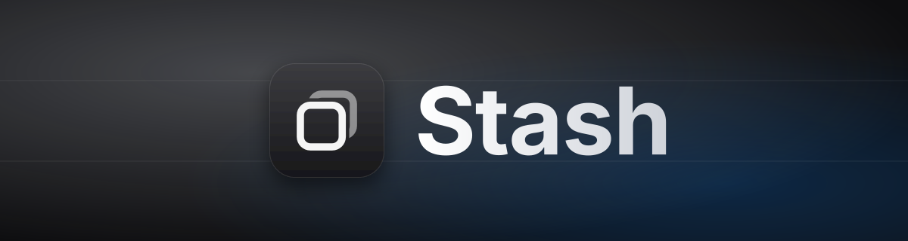
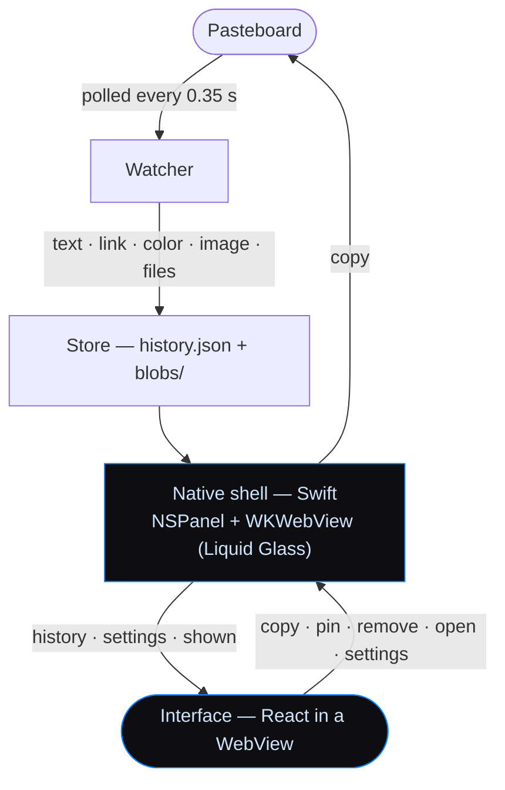

<p align="center">
  
</p>

<p align="center">
  
  
  
  
</p>

Everything you copy, one shortcut away. Stash is a clipboard history for
macOS that lives in the menu bar: it quietly keeps what you copy — text,
links, colors, images and files — and brings it back with **⌥⌘V**.

No Dock icon, no window to manage, no permissions to grant. Press the
shortcut, type a few letters, hit Enter.

## Index

- [Why](#why)
- [Installation](#installation)
- [Usage](#usage)
- [Keyboard shortcuts](#keyboard-shortcuts)
- [Settings](#settings)
- [Privacy](#privacy)
- [How it fits together](#how-it-fits-together)
- [Known limitations](#known-limitations)
- [License](#license)

## Why

macOS only remembers the last thing you copied. Most clipboard managers fix
that by adding a lot more: folders, snippets, sync, rules. Stash keeps only
what you reach for:

- **One panel.** A search field and the list, hanging from the menu bar
  icon. Settings live in a separate window, out of the way.
- **Knows what it holds.** Text, links, colors and images each get their own
  look; images and files show a thumbnail, and every row says which app it
  came from and when.
- **Copies, doesn't paste.** Picking an item puts it back on the clipboard.
  That's why Stash doesn't need the Accessibility permission.
- **Native, not Electron.** A real macOS panel with Liquid Glass behind the
  interface (a regular blur on macOS 14 and 15).

## Installation

Stash is built from source. You need the Xcode command line tools
(`xcode-select --install`) and Node:

```sh
brew install node
git clone https://github.com/alexcalatyd/Stash.git
cd Stash
./build.sh --install
```

That builds the interface, compiles the app, draws its icon, signs it
ad hoc and installs it into `/Applications`. It needs Apple Silicon and
macOS 14 or later. Built on your own machine, Gatekeeper doesn't get in the
way.

The first time it runs, Stash adds itself to your login items so it's there
after a restart. You can turn that off in its settings.

## Usage

1. Copy things as usual. Stash keeps them in the background, even if you
   never open it.
2. Press **⌥⌘V** (or click the icon in the menu bar).
3. Type to search, move with the arrows, press **Enter** to copy.

Then paste wherever you want with ⌘V. Copying something that's already in
the history moves it to the top instead of duplicating it. Pinned items stay
at the top and never expire.

Right-click the menu bar icon for settings and quitting.

The interface speaks Spanish and English; the `ES` / `EN` button in the
settings window switches it, menus included, and remembers your choice.

## Keyboard shortcuts

| Shortcut | Action |
|---|---|
| **⌥⌘V** | Open or close the panel, from anywhere |
| **↩** | Copy the selected item |
| **⇧↩** | Copy as plain text (no formatting) |
| **⌘1** … **⌘9** | Copy one of the first nine items |
| **⇥** | Preview the selected item |
| **⌘P** | Pin or unpin |
| **⌘⌫** | Delete (with the search field empty) |
| **⌘↩** | Open a link, or show a file in Finder |
| **Esc** | Close |

## Settings

Open them from the gear in the panel or by right-clicking the menu bar icon.

- **Open at login** — on by default.
- **Pause** — stop recording for a while; the panel says so and offers
  to resume.
- **History size** — 100, 500 (default), 1,000 or 5,000 items. Pinned items
  don't count.
- **Clear history** — removes everything except what's pinned.

## Privacy

Everything stays on your Mac, in
`~/Library/Application Support/Stash/` (`history.json` plus a `blobs/`
folder for images and rich text). Nothing is sent anywhere.

Stash skips anything a password manager marks as concealed or transient
(`org.nspasteboard.ConcealedType`, `TransientType`, 1Password and the like),
so passwords you copy from them don't end up in the history.

## How it fits together



- `native/main.swift` — the whole Mac app in one file: the clipboard
  watcher, the history store, the panel, the settings window, the global
  shortcut and the login item. Compiled with `swiftc`, no Xcode project.
- `native/icon.swift` — draws the app icon.
- `ui/` — the interface: Vite, React, TypeScript and Tailwind. `npm run dev`
  inside it runs it in a browser with sample data; open `/#panel` or
  `/#settings`.
- `build.sh` — builds `build/Stash.app`; `--install` copies it to
  `/Applications` and opens it.

<details>
<summary><b>How the interface talks to the app</b></summary>
<br>

The interface is served from a custom `app://local/` scheme, which also
hands out history images (`/__blob/…`) and the icons of the apps things
were copied from (`/__icon/<bundle id>`). It sends small messages — `copy`,
`pin`, `remove`, `open`, `settings` — through
`window.webkit.messageHandlers.stash`, and the native side answers by
calling `window.__native(event)` with `history`, `settings` or `shown`.

</details>

<details>
<summary><b>Why no permissions</b></summary>
<br>

Reading the clipboard doesn't need any. The global shortcut uses Carbon's
`RegisterEventHotKey`, which doesn't need Input Monitoring. And since Stash
only copies instead of simulating ⌘V in the app you were using, it doesn't
need Accessibility either.

</details>

<details>
<summary><b>Debugging the interface inside the app</b></summary>
<br>

```sh
STASH_DEBUG=1 /Applications/Stash.app/Contents/MacOS/Stash
```

Then open Safari's Develop menu to inspect the panel's web view.

</details>

## Known limitations

- **Apple Silicon only**, macOS 14 or later, and for now built from source.
- The shortcut is fixed to ⌥⌘V.
- You can't exclude specific apps yet (password managers are already
  skipped).
- Selecting an item copies it; you still paste it yourself with ⌘V.

## License

MIT — see [LICENSE](LICENSE). The npm packages the interface uses keep their
own licenses: see [THIRD_PARTY_NOTICES.md](THIRD_PARTY_NOTICES.md).
